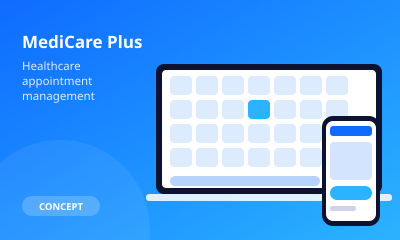
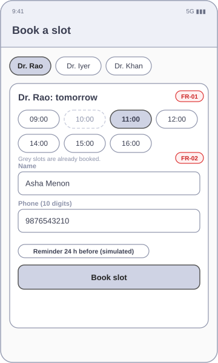
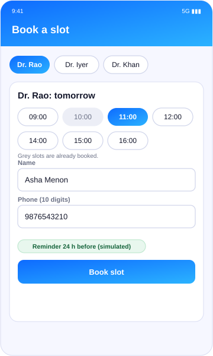
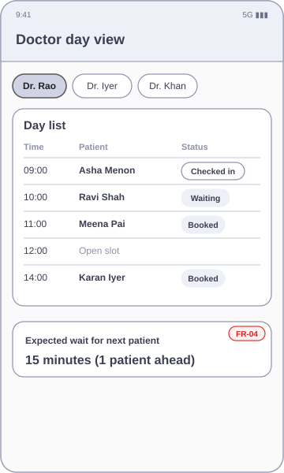
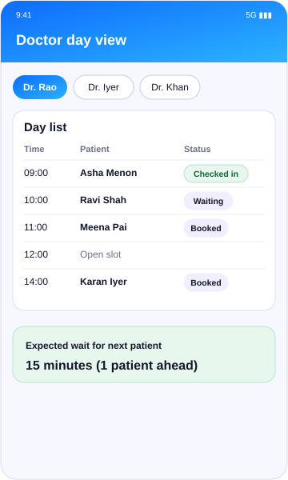
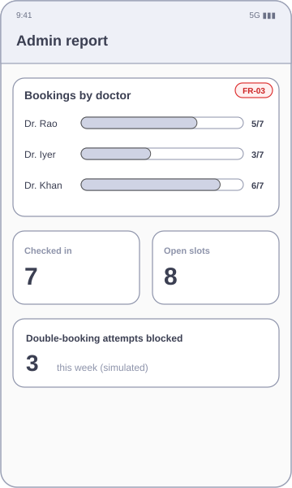
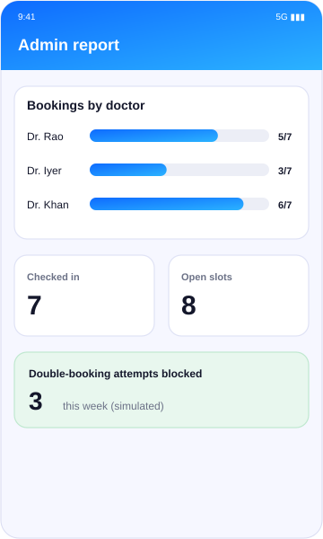

# MediCare Plus

> **Concept project.** Independent case study created to demonstrate BA and UI/UX method. The client, users and data are fictional, and the KPI baselines and targets are assumptions. Nothing here is client work.

**Healthcare appointment management.** Patient, doctor and admin flows for a clinic that books by phone and paper.

| Item | Detail |
|---|---|
| Project type | Concept project, healthcare |
| My role | Business Analyst and UI/UX Designer |
| Duration | Independent, self-paced |
| Team | Solo |
| Tools | Figma, BPMN, Power BI |

## Business problem

Patients wait long and double bookings happen because slots live in separate notebooks.

## Business objectives

- Remove double bookings
- Show expected wait time
- Cut front-desk phone load

## Stakeholders

| Stakeholder | Interest |
|---|---|
| Business owner | Clinic director: patient throughput |
| End users | Patients and doctors |
| Operations | Reception: one shared calendar |
| Customer support | Patient helpline: fewer booking calls |
| Product / IT | A secure, role-based system |
| Admin | Clinic admin: schedules and reports |

## Personas

| Name | Profile | Goal | Pain |
|---|---|---|---|
| Lakshmi | 58, retired | Books for herself | Cannot reach the clinic by phone |
| Dr. Rao | 44, physician | Sees 30 patients a day | Walk-ins disrupt the schedule |

## User journey

| Stage | What happens |
|---|---|
| Need | Feels unwell |
| Book | Chooses doctor and slot |
| Remind | Gets a reminder |
| Check in | Sees wait time |
| Follow up | Rebooks |

## Screens

| Wireframe | High fidelity |
|---|---|
|  Book a slot |  Book a slot |
|  Doctor day view |  Doctor day view |
|  Admin report |  Admin report |

Schematic screen designs, not final screenshots.

## Documents

| Document | Contents |
|---|---|
| [01-brd.md](docs/01-brd.md) | Business Requirements Document (summary) |
| [02-frd.md](docs/02-frd.md) | Functional and non-functional requirements |
| [03-user-stories.md](docs/03-user-stories.md) | User stories and acceptance criteria |
| [04-process-flow.md](docs/04-process-flow.md) | Process flow (BPMN style) and sitemap |
| [05-jira-backlog.md](docs/05-jira-backlog.md) | Jira-style backlog |
| [06-rtm.md](docs/06-rtm.md) | Requirements traceability matrix |
| [07-uat.md](docs/07-uat.md) | UAT scenarios |
| [08-kpis.md](docs/08-kpis.md) | KPIs and data analysis |

## Prototype

A working front-end prototype of the four functional requirements: [prototype/index.html](prototype/index.html). It uses HTML, CSS and JavaScript only, with fictional data saved in your browser. There is no backend, and payments, messages and codes are simulated. After enabling GitHub Pages on this repo it runs at https://kiraninbusiness.github.io/ba-ux-case-studies/medicare/prototype/

## Results

**Target outcome (not a measured result):** no double bookings and a shorter average wait. Figures are assumed baselines for the simulation.

Portfolio page: https://kiraninbusiness.github.io/portfolio/#case-medicare
