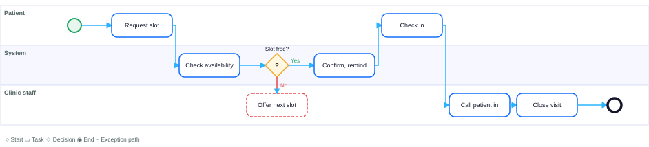
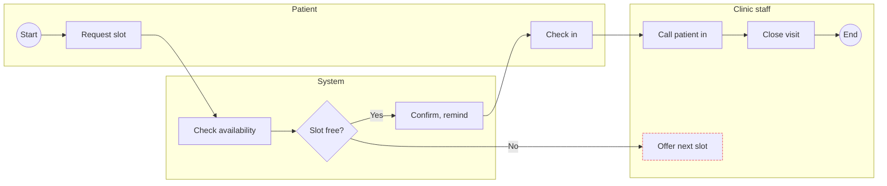
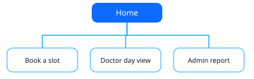

# MediCare Plus: Process flow

> **Concept project.** Independent case study created to demonstrate BA and UI/UX method. The client, users and data are fictional, and the KPI baselines and targets are assumptions. Nothing here is client work.

[← All case studies](../README.md)

## Current state

Reception books by phone in a paper register and slots overlap.

## Future-state flow

Same flow as a diagram GitHub renders from text:

## Sitemap

