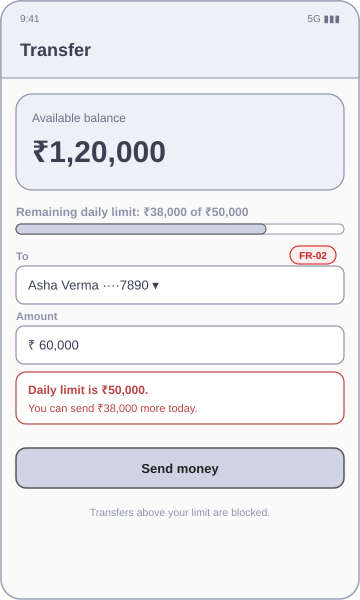
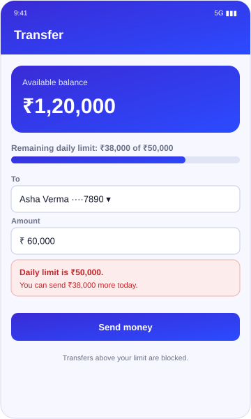
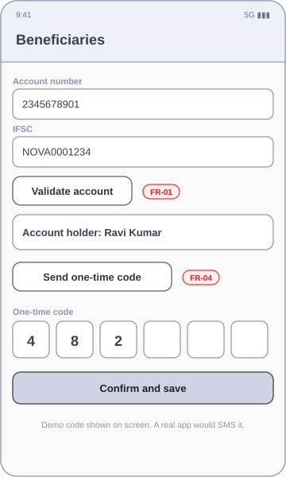
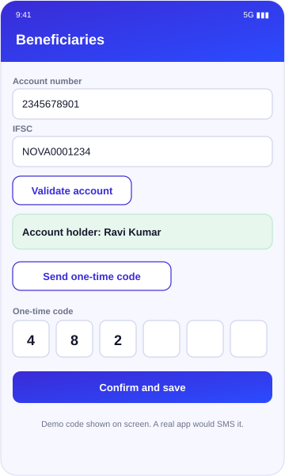
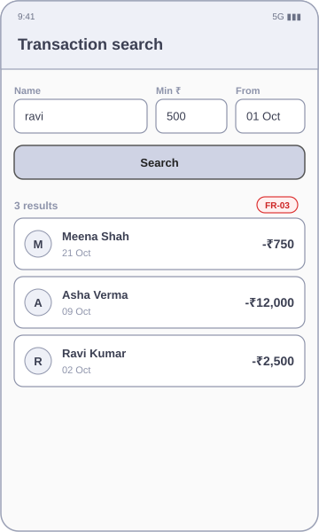
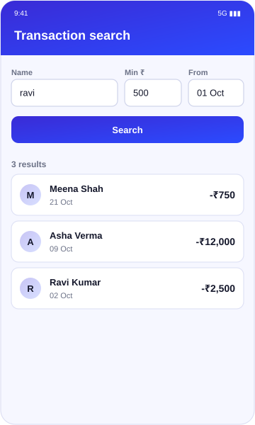

# NovaBank

> **Concept project.** Independent case study created to demonstrate BA and UI/UX method. The client, users and data are fictional, and the KPI baselines and targets are assumptions. Nothing here is client work.

**Mobile banking.** A mobile banking flow for transfers, beneficiaries and transaction search, using simulated data.

| Item | Detail |
|---|---|
| Project type | Concept project, fintech |
| My role | Business Analyst and UI/UX Designer |
| Duration | Independent, self-paced |
| Team | Solo |
| Tools | Figma, SQL, Excel |

## Business problem

Customers drop transfers when adding a beneficiary is slow and security prompts are unclear.

## Business objectives

- Raise transfer completion
- Speed up adding a beneficiary
- Make security steps understandable

## Stakeholders

| Stakeholder | Interest |
|---|---|
| Business owner | Retail banking head: digital adoption |
| End users | Customers making transfers |
| Operations | Payments team: clean transfer data |
| Customer support | Fewer failed-transfer calls |
| Product / IT | Secure, auditable transfers |
| Admin | Risk team: limits and fraud rules |

## Personas

| Name | Profile | Goal | Pain |
|---|---|---|---|
| Neha | 34, accountant | Pays rent and bills monthly | Re-enters details each time |
| Imran | 62, shopkeeper | Uses a basic phone | Fears wrong transfers |

## User journey

| Stage | What happens |
|---|---|
| Open | Logs in |
| Choose | Picks a beneficiary |
| Verify | Enters code |
| Send | Confirms amount |
| Check | Finds receipt |

## Screens

| Wireframe | High fidelity |
|---|---|
|  Transfer |  Transfer |
|  Beneficiaries |  Beneficiaries |
|  Transaction search |  Transaction search |

Schematic screen designs, not final screenshots.

## Documents

| Document | Contents |
|---|---|
| [01-brd.md](docs/01-brd.md) | Business Requirements Document (summary) |
| [02-frd.md](docs/02-frd.md) | Functional and non-functional requirements |
| [03-user-stories.md](docs/03-user-stories.md) | User stories and acceptance criteria |
| [04-process-flow.md](docs/04-process-flow.md) | Process flow (BPMN style) and sitemap |
| [05-jira-backlog.md](docs/05-jira-backlog.md) | Jira-style backlog |
| [06-rtm.md](docs/06-rtm.md) | Requirements traceability matrix |
| [07-uat.md](docs/07-uat.md) | UAT scenarios |
| [08-kpis.md](docs/08-kpis.md) | KPIs and data analysis |

## Prototype

A working front-end prototype of the four functional requirements: [prototype/index.html](prototype/index.html). It uses HTML, CSS and JavaScript only, with fictional data saved in your browser. There is no backend, and payments, messages and codes are simulated. After enabling GitHub Pages on this repo it runs at https://kiraninbusiness.github.io/ba-ux-case-studies/novabank/prototype/

## Results

**Target outcome (not a measured result):** higher completion and fewer support calls. Figures are assumed for the simulation.

Portfolio page: https://kiraninbusiness.github.io/portfolio/#case-novabank
