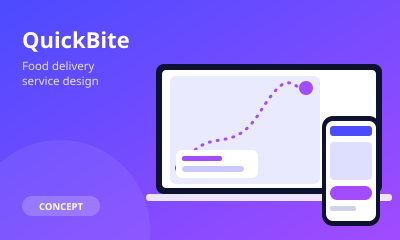
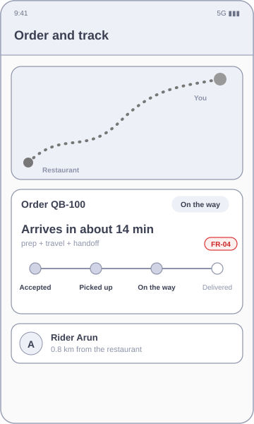
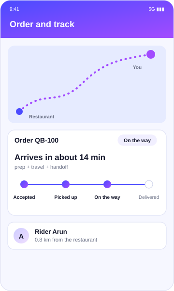
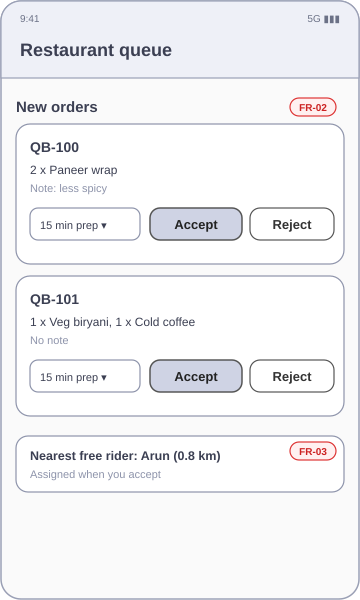
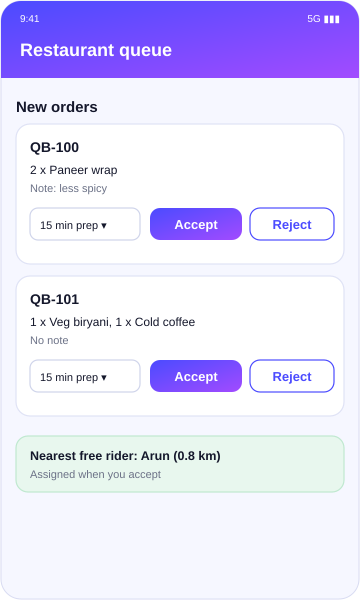
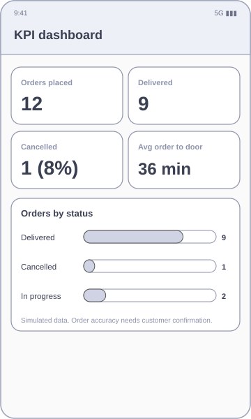
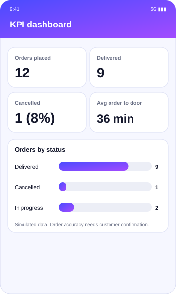

# QuickBite

> **Concept project.** Independent case study created to demonstrate BA and UI/UX method. The client, users and data are fictional, and the KPI baselines and targets are assumptions. Nothing here is client work.

**Food delivery service design.** A service design of ordering, restaurant and delivery-partner journeys, with the KPIs to run it.

| Item | Detail |
|---|---|
| Project type | Concept project, food delivery |
| My role | Business Analyst and UI/UX Designer |
| Duration | Independent, self-paced |
| Team | Solo |
| Tools | Figma, BPMN, Power BI |

## Business problem

Orders arrive late and wrong because the restaurant and the rider are not in sync.

## Business objectives

- Shorten order-to-door time
- Raise order accuracy
- Give customers honest tracking

## Stakeholders

| Stakeholder | Interest |
|---|---|
| Business owner | Operations head: delivery time and cost |
| End users | Customers and riders |
| Operations | Restaurant partners: a clear queue |
| Customer support | Fewer where-is-my-order chats |
| Product / IT | Reliable live tracking |
| Admin | Dispatcher: rider assignment |

## Personas

| Name | Profile | Goal | Pain |
|---|---|---|---|
| Karan | 26, developer | Orders dinner late | Cannot trust arrival times |
| Sunita | 45, restaurant owner | Runs a busy kitchen | Misses orders on messages |

## User journey

| Stage | What happens |
|---|---|
| Order | Picks food |
| Prepare | Restaurant confirms |
| Pickup | Rider collects |
| Deliver | Rider travels |
| Rate | Gives feedback |

## Screens

| Wireframe | High fidelity |
|---|---|
|  Order and track |  Order and track |
|  Restaurant queue |  Restaurant queue |
|  KPI dashboard |  KPI dashboard |

Schematic screen designs, not final screenshots.

## Documents

| Document | Contents |
|---|---|
| [01-brd.md](docs/01-brd.md) | Business Requirements Document (summary) |
| [02-frd.md](docs/02-frd.md) | Functional and non-functional requirements |
| [03-user-stories.md](docs/03-user-stories.md) | User stories and acceptance criteria |
| [04-process-flow.md](docs/04-process-flow.md) | Process flow (BPMN style) and sitemap |
| [05-jira-backlog.md](docs/05-jira-backlog.md) | Jira-style backlog |
| [06-rtm.md](docs/06-rtm.md) | Requirements traceability matrix |
| [07-uat.md](docs/07-uat.md) | UAT scenarios |
| [08-kpis.md](docs/08-kpis.md) | KPIs and data analysis |

## Prototype

A working front-end prototype of the four functional requirements: [prototype/index.html](prototype/index.html). It uses HTML, CSS and JavaScript only, with fictional data saved in your browser. There is no backend, and payments, messages and codes are simulated. After enabling GitHub Pages on this repo it runs at https://kiraninbusiness.github.io/ba-ux-case-studies/quickbite/prototype/

## Results

**Target outcome (not a measured result):** faster delivery and higher accuracy. Figures are assumed for the simulation.

Portfolio page: https://kiraninbusiness.github.io/portfolio/#case-quickbite
