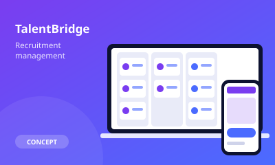
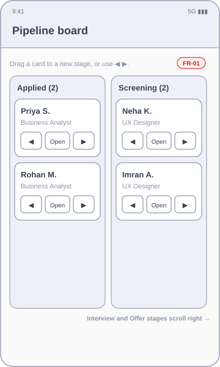
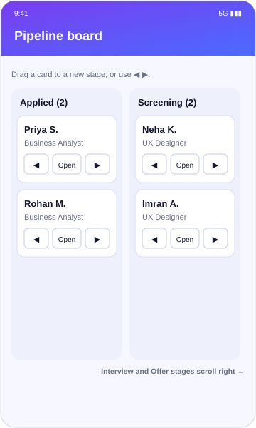
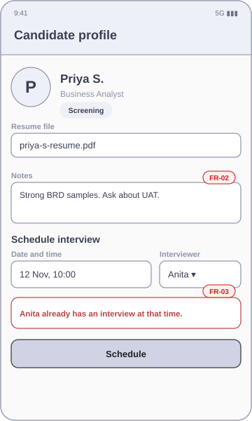
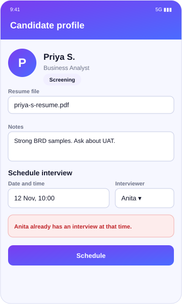
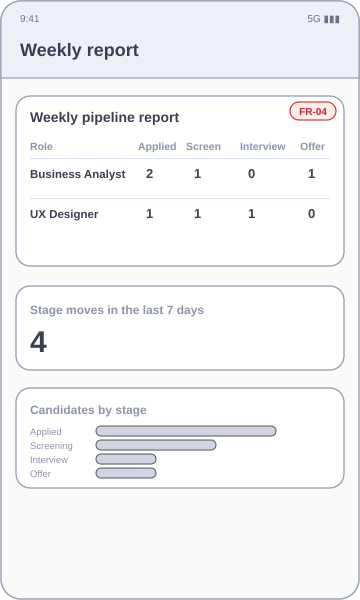
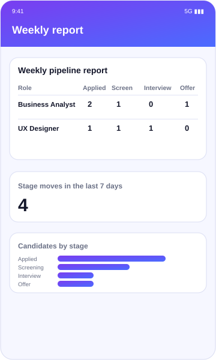

# TalentBridge

> **Concept project.** Independent case study created to demonstrate BA and UI/UX method. The client, users and data are fictional, and the KPI baselines and targets are assumptions. Nothing here is client work.

**Recruitment management.** A shared candidate pipeline to replace spreadsheets and email threads for a small recruiting team.

| Item | Detail |
|---|---|
| Project type | Concept project, HR tech |
| My role | Business Analyst and UI/UX Designer |
| Duration | Independent, self-paced |
| Team | Solo |
| Tools | Figma, Jira, Power BI |

## Business problem

Candidates get lost between recruiters, and nobody sees the true status of a role.

## Business objectives

- One pipeline for every role
- Fewer lost candidates
- Faster shortlist

## Stakeholders

| Stakeholder | Interest |
|---|---|
| Business owner | HR head: time to hire |
| End users | Recruiters and hiring managers |
| Operations | Coordinators: interview scheduling |
| Customer support | Candidates: status questions |
| Product / IT | Access control and exports |
| Admin | HR admin: roles and reports |

## Personas

| Name | Profile | Goal | Pain |
|---|---|---|---|
| Anita | 29, recruiter | Handles 6 roles | Tracks in 3 spreadsheets |
| Vikram | 41, hiring manager | Reviews shortlists | Cannot see status |

## User journey

| Stage | What happens |
|---|---|
| Source | Adds candidate |
| Screen | Rates the profile |
| Interview | Schedules rounds |
| Decide | Manager picks |
| Close | Offer sent |

## Screens

| Wireframe | High fidelity |
|---|---|
|  Pipeline board |  Pipeline board |
|  Candidate profile |  Candidate profile |
|  Weekly report |  Weekly report |

Schematic screen designs, not final screenshots.

## Documents

| Document | Contents |
|---|---|
| [01-brd.md](docs/01-brd.md) | Business Requirements Document (summary) |
| [02-frd.md](docs/02-frd.md) | Functional and non-functional requirements |
| [03-user-stories.md](docs/03-user-stories.md) | User stories and acceptance criteria |
| [04-process-flow.md](docs/04-process-flow.md) | Process flow (BPMN style) and sitemap |
| [05-jira-backlog.md](docs/05-jira-backlog.md) | Jira-style backlog |
| [06-rtm.md](docs/06-rtm.md) | Requirements traceability matrix |
| [07-uat.md](docs/07-uat.md) | UAT scenarios |
| [08-kpis.md](docs/08-kpis.md) | KPIs and data analysis |

## Prototype

A working front-end prototype of the four functional requirements: [prototype/index.html](prototype/index.html). It uses HTML, CSS and JavaScript only, with fictional data saved in your browser. There is no backend, and payments, messages and codes are simulated. After enabling GitHub Pages on this repo it runs at https://kiraninbusiness.github.io/ba-ux-case-studies/talentbridge/prototype/

## Results

**Target outcome (not a measured result):** faster shortlists and fewer lost candidates. Figures are assumed for the simulation.

Portfolio page: https://kiraninbusiness.github.io/portfolio/#case-talentbridge
