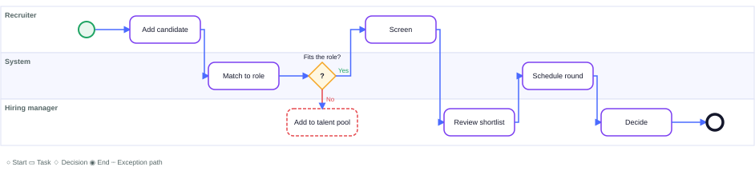
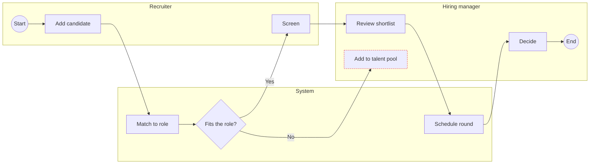
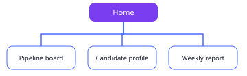

# TalentBridge: Process flow

> **Concept project.** Independent case study created to demonstrate BA and UI/UX method. The client, users and data are fictional, and the KPI baselines and targets are assumptions. Nothing here is client work.

[← All case studies](../README.md)

## Current state

Candidates live in spreadsheets and email threads, and nobody sees the true status.

## Future-state flow

Same flow as a diagram GitHub renders from text:

## Sitemap

