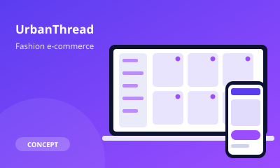
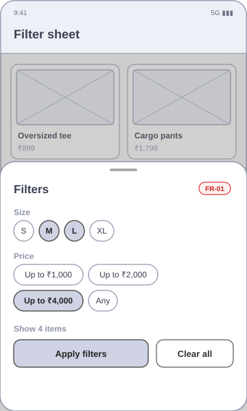
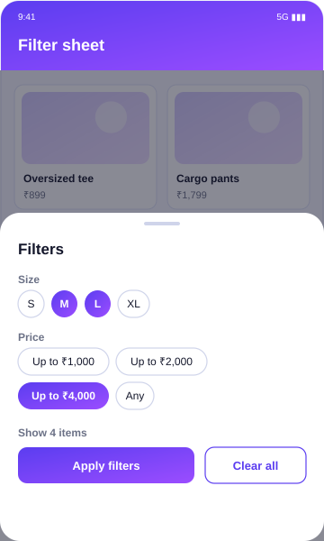
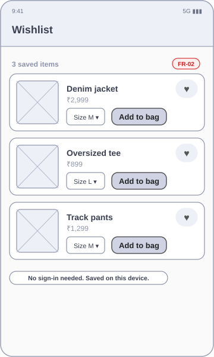
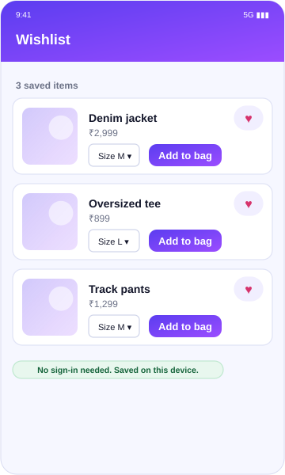
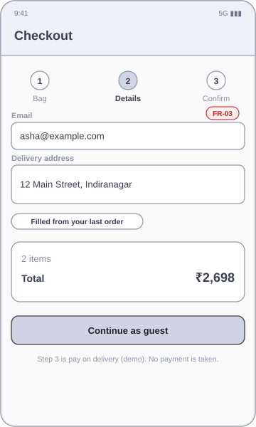
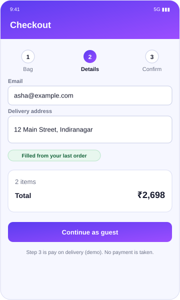

# UrbanThread

> **Concept project.** Independent case study created to demonstrate BA and UI/UX method. The client, users and data are fictional, and the KPI baselines and targets are assumptions. Nothing here is client work.

**Fashion e-commerce.** A redesign of a mid-size fashion shopping app, focused on discovery, filters and checkout.

| Item | Detail |
|---|---|
| Project type | Concept project, fashion e-commerce |
| My role | Business Analyst and UI/UX Designer |
| Duration | Independent, self-paced |
| Team | Solo |
| Tools | Figma, Jira, Excel |

## Business problem

Shoppers abandon carts when filters are slow and checkout asks for too much.

## Business objectives

- Cut checkout steps
- Make filters usable with one hand
- Show order status without a support call

## Stakeholders

| Stakeholder | Interest |
|---|---|
| Business owner | Head of e-commerce: conversion and sales |
| End users | Shoppers: quick filters and checkout |
| Operations | Warehouse: accurate stock and dispatch |
| Customer support | Fewer order-status calls |
| Product / IT | Maintainable filters and checkout |
| Admin | Merchandiser: collections and promotions |

## Personas

| Name | Profile | Goal | Pain |
|---|---|---|---|
| Riya | 25, marketing associate | Shops on her commute | Hates retyping her address |
| Sam | 31, engineer | Buys twice a year | Cannot compare items |

## User journey

| Stage | What happens |
|---|---|
| Discover | Sees a sale banner |
| Filter | Narrows by size and price |
| Save | Adds to wishlist |
| Pay | Guest checkout |
| Track | Follows delivery |

## Screens

| Wireframe | High fidelity |
|---|---|
|  Filter sheet |  Filter sheet |
|  Wishlist |  Wishlist |
|  Checkout |  Checkout |

Schematic screen designs, not final screenshots.

## Documents

| Document | Contents |
|---|---|
| [01-brd.md](docs/01-brd.md) | Business Requirements Document (summary) |
| [02-frd.md](docs/02-frd.md) | Functional and non-functional requirements |
| [03-user-stories.md](docs/03-user-stories.md) | User stories and acceptance criteria |
| [04-process-flow.md](docs/04-process-flow.md) | Process flow (BPMN style) and sitemap |
| [05-jira-backlog.md](docs/05-jira-backlog.md) | Jira-style backlog |
| [06-rtm.md](docs/06-rtm.md) | Requirements traceability matrix |
| [07-uat.md](docs/07-uat.md) | UAT scenarios |
| [08-kpis.md](docs/08-kpis.md) | KPIs and data analysis |

## Prototype

A working front-end prototype of the four functional requirements: [prototype/index.html](prototype/index.html). It uses HTML, CSS and JavaScript only, with fictional data saved in your browser. There is no backend, and payments, messages and codes are simulated. After enabling GitHub Pages on this repo it runs at https://kiraninbusiness.github.io/ba-ux-case-studies/urbanthread/prototype/

## Results

**Target outcome (not a measured result):** a shorter checkout and fewer order-status tickets. Targets are assumptions for this simulation.

Portfolio page: https://kiraninbusiness.github.io/portfolio/#case-urbanthread
